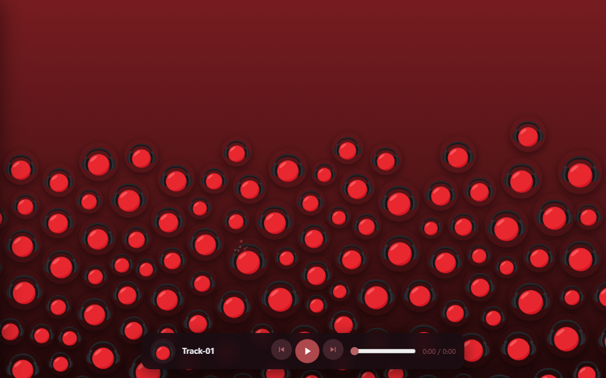
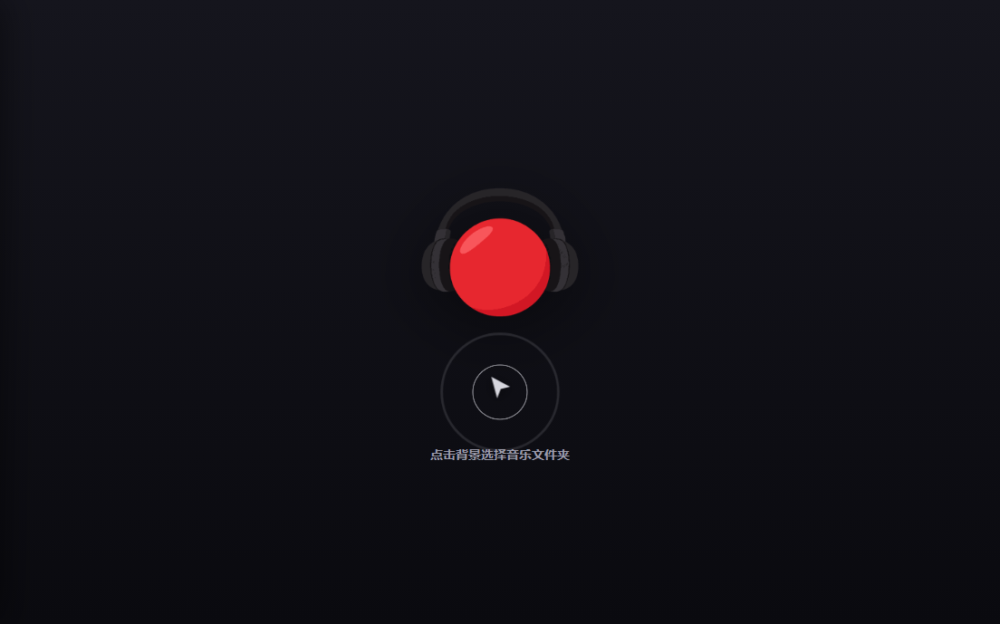
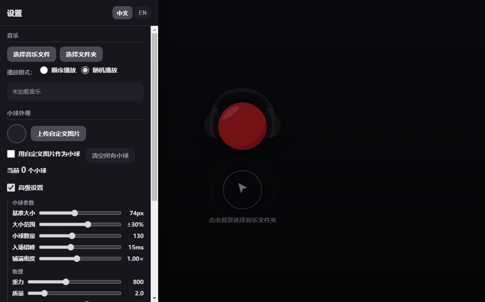

# Bopple · 封面小球音乐播放器

> 把专辑封面变成会随音乐弹跳的小球。




Bopple 是一个本地音乐播放器：选一个音乐文件夹，每首歌的专辑封面都会变成一颗小球从屏幕上方落下，堆在窗口里、互相碰撞、被拖拽甩飞。播放时，低频（鼓点、贝斯）会把小球托起跳动，人声频段会让它们轻微抖动 —— 封面就是小球，小球就是封面。

整个界面只有 **一个 `app.html`**（原生 JS + Canvas，无框架、无构建步骤），Electron 只负责把它变成桌面软件：记住你的音乐文件夹，下次打开直接自动扫描播放。

---

## ✨ 功能特性

- **封面即小球** —— 自动解析 MP3（ID3v2 / APIC）、M4A（MP4 `covr`）、FLAC（`PICTURE`）里的内嵌封面；没有封面的歌使用内置耳机封面。
- **音乐驱动的物理** —— Web Audio `AnalyserNode` 分离低频与人声：低频踩点向上顶起小球，人声让小球轻微高频抖动，鼓点触发粒子爆发。
- **还不错的碰撞手感** —— 空间哈希宽相位 + 多次迭代冲量解算，支持睡眠、位置松弛、屏幕外软弹簧，堆叠静置时不会自己抖。
- **自适应铺满** —— 按窗口面积自动决定屏幕里能放多少颗球，多余的球停到屏幕外，窗口放大 / 全屏时自然回填；「铺满密度」滑杆可从 0.5× 调到 1.6×。
- **入场错峰 + 回弹缓动** —— 小球依次落下，不会一起闪出来。
- **主题跟随封面** —— 取封面平均色，自动生成背景渐变、强调色、面板色，整个界面跟着专辑换色。
- **配置自动保存** —— 所有滑杆 / 开关 / 播放模式 / 语言 / 自定义图片，改完即存，下次打开原样恢复。
- **记住音乐文件夹**（桌面版）—— 选一次，之后每次启动自动扫描并随机播放，不再弹窗询问。
- **单文件也能玩** —— `app.html` 直接用浏览器打开就是一个完整的网页版。

---

## 🖼️ 截图

| 首次启动 | 高级设置 |
| --- | --- |
|  |  |

---

## 🚀 快速开始

### 方式一：浏览器直接打开（零依赖）

双击 `app.html`，用 Chrome / Edge 等 Chromium 内核浏览器打开 → 点击背景选择音乐文件夹（浏览器需要授权一次）→ 开始播放。

> Firefox / Safari 缺少 File System Access API，会退化成普通的文件夹选择框，功能仍可用。

### 方式二：桌面版（推荐）

从 [Releases](../../releases) 下载 `Bopple-win32-x64.zip`（发布后会有），解压后双击 `Bopple.exe` 即用。

或者自己从源码构建（需要 Node.js 18+，pnpm 或 npm 均可）：

```bash
pnpm install        # 或 npm install
pnpm run pack       # 产物：dist/Bopple-win32-x64/Bopple.exe
```

国内下载 Electron 慢的话，先设置镜像再安装：

```powershell
$env:ELECTRON_MIRROR = "https://npmmirror.com/mirrors/electron/"
pnpm install
```

开发模式（无需打包）：

```bash
pnpm start
```

---

## 🎮 使用

| 操作 | 说明 |
| --- | --- |
| `Tab` | 打开 / 关闭设置面板 |
| `Esc` | 关闭设置面板 |
| 点击空白背景 | 没有加载音乐时，选择音乐文件夹 |
| 拖动小球 | 抓住小球移动，松手会按拖动速度甩出去 |
| 底部播放器 | 上一首 / 播放暂停 / 下一首 / 拖动进度条 |

音乐加载后会从播放列表里随机选一首开始，切歌时旧球落下、新球重新铺满。

---

## 🎛️ 参数说明

设置 → 高级设置里可调（全部会自动保存）：

**小球参数**

| 参数 | 范围 | 默认 | 说明 |
| --- | --- | --- | --- |
| 基准大小 | 40–120 px | 74 px | 小球直径基准值 |
| 大小范围 | 0–50% | ±30% | 每颗球随机的尺寸浮动 |
| 小球数量 | 20–300 | 130 | 一次生成的小球总数 |
| 入场错峰 | 0–40 ms | 15 ms | 每颗球依次延后的时间 |
| 铺满密度 | 0.5–1.6× | 1.00× | 屏幕内能容纳多少球的倍率，越大越满 |

**物理**

| 参数 | 范围 | 默认 | 说明 |
| --- | --- | --- | --- |
| 重力 | 0–2000 | 800 | 越大下落越快、堆得越实 |
| 质量 | 0.5–10 | 2 | 影响碰撞时的动量交换 |
| 弹性 | 0.1–1.5 | 1.00 | 越大越弹，调小更像黏土 |
| 空气阻尼 | 0–5 | 1.0 | 速度衰减强度 |
| 最大速度 | 500–4000 | 2400 | 速度上限，防止甩出穿透 |

**粒子特效**

| 参数 | 范围 | 默认 | 说明 |
| --- | --- | --- | --- |
| 启用粒子 | 开 / 关 | 开 | 碰撞火花 |
| 触发速度 | 0–1500 | 320 | 碰撞速度超过多少才喷粒子 |
| 每次数量 | 1–30 | 8 | 单次爆发粒子数 |
| 冷却(秒) | 0–0.5 | 0.08 | 两次爆发的最小间隔 |

**灵敏度**

| 参数 | 范围 | 默认 | 说明 |
| --- | --- | --- | --- |
| 跳动灵敏度（低频） | 0–3 | 0.7 | 鼓点把球顶起来的高度 |
| 抖动灵敏度（人声） | 0–3 | 2.0 | 人声频段造成的高频抖动 |

---

## 💾 数据与隐私

Bopple 完全本地运行：**不联网、不上传、不含统计**。

- **桌面版配置**：`%APPDATA%\Bopple\config.json`（滑杆值、播放模式、语言、自定义图片、音乐文件夹路径）
- **浏览器配置**：`localStorage` 键 `bopple_settings_v1`（同一份内容）
- **想重置**：关掉软件删掉上面的文件 / 清掉 localStorage 即可，软件会回到首次启动状态。

桌面版通过 `preload.js` 暴露的 `window.bopple` 调用主进程完成「选文件夹、扫描文件、按路径读取音频字节」，音频以 Blob URL 交给 `<audio>`，因此不需要任何本地服务器。

---

## 📁 项目结构

```
bopple/
├─ app.html              # 全部界面 + 物理 + 音频分析 + 封面解析（单文件，约 84 KB）
├─ main.js               # Electron 主进程：窗口、配置文件读写、文件夹扫描、IPC
├─ preload.js            # contextBridge → window.bopple（配置 / 选文件夹 / 扫描 / 读文件）
├─ icon.ico / icon.png   # 应用图标（多尺寸 ICO + 256px PNG）
├─ scripts/pack.js       # 打包脚本（@electron/packager）
├─ screenshots/          # README 截图
├─ package.json
├─ README.md
└─ LICENSE
```

---

## 🔧 实现要点

1. **物理**：每帧用空间哈希重建宽相位，圆-圆窄相位做 4 次迭代的冲量解算；速度低于阈值若干帧后进入睡眠，静止叠放不抖；穿透允许 0.6px 的 SLOP，位置校正只走 60%，避免过冲抖动。
2. **自适应容量**：`floor(窗口面积 / (π·r²·1.3) × 密度)` 估算屏幕能放多少球，超出的球 `park` 到屏幕上方并缩小淡出，窗口变化时平滑回填。
3. **音频分析**：`MediaElementSource → AnalyserNode`（fftSize 1024），低频取前 7 个 bin、人声取 8–70 个 bin，平滑后分别驱动跳动和抖动。
4. **封面解析**：手写 ID3v2（含 APIC 图片帧）、MP4（`covr` box）、FLAC（`PICTURE` block）解析器，纯 ArrayBuffer 操作，不依赖第三方库。
5. **主题**：把封面缩到 40×40 取平均色，派生出背景渐变与一组 CSS 变量（`--accent` / `--panel` / `--border` …）。
6. **桌面集成**：`contextIsolation: true` + `sandbox: true` + 仅经 `contextBridge` 暴露 6 个方法，主进程负责 `fs`、`dialog` 和配置落盘。

---

## ❓ 常见问题

**第一次打开要选文件夹，能不能自动？**
桌面版选一次就会记住路径，之后启动自动扫描，不再询问。浏览器受安全策略限制，可能需要每次授权（用 `File System Access` 句柄记忆，授权状态由浏览器决定）。

**小球不跳？**
浏览器（以及部分系统的自动播放策略）需要先在页面点一下 —— 点播放键或拖动小球 —— 才会真正出声；确认播放器时间在走、歌曲有低频内容。

**有的歌没有封面？**
没有内嵌封面的音频会用内置的耳机封面；也可以 设置 → 小球外观 → 上传自定义图片，强制所有球显示同一张图。

**支持哪些格式？**
`.mp3 .m4a .aac .flac .ogg .oga .opus .wav .mp4`（受 Chromium 解码能力限制，`wma` / `wv` 不支持）。

**exe 为什么有 180 MB？**
Electron 自带整个 Chromium。`pnpm run pack` 已经启用 `--asar`，把应用代码打成一个包，体积主要来自运行时本身。

**Windows 提示「已保护你的电脑」？**
exe 未做代码签名，点「更多信息」→「仍要运行」即可；也可以自行签名。

---

## 🤝 贡献

欢迎 Issue / PR。改代码前建议直接用浏览器打开 `app.html` 调试（界面、物理、音频分析全在里面，桌面版只是外壳）。

- 代码风格：`app.html` 保持单文件、原生 JS、无第三方运行时依赖。
- 提 PR 请说明改的是哪个参数 / 哪个行为，最好附截图或录屏。
- 本项目不附带任何音乐文件，请自备合法来源的音频。

---

## 📄 许可证

[MIT](LICENSE) © 2026 Bopple contributors

使用到的第三方组件：Electron、Chromium（各自遵循其开源许可证）。项目内不包含任何音频内容。

---

## English

**Bopple** is a local music player that turns album art into bouncing balls. Drop a folder of music in, and every track's cover becomes a ball that falls, collides, stacks and reacts to the music: bass kicks the balls upward, vocals add a high-frequency shake, and the whole UI theme follows the dominant color of the artwork.

- Single-file UI (`app.html`, vanilla JS + Canvas, no build step) that also runs straight in the browser.
- Electron shell adds a native folder picker, remembers your music folder, auto-scans it on launch, and persists every setting to `%APPDATA%\Bopple\config.json`.

```bash
pnpm install
pnpm run pack     # → dist/Bopple-win32-x64/Bopple.exe
```

MIT licensed, no telemetry, no bundled audio.
